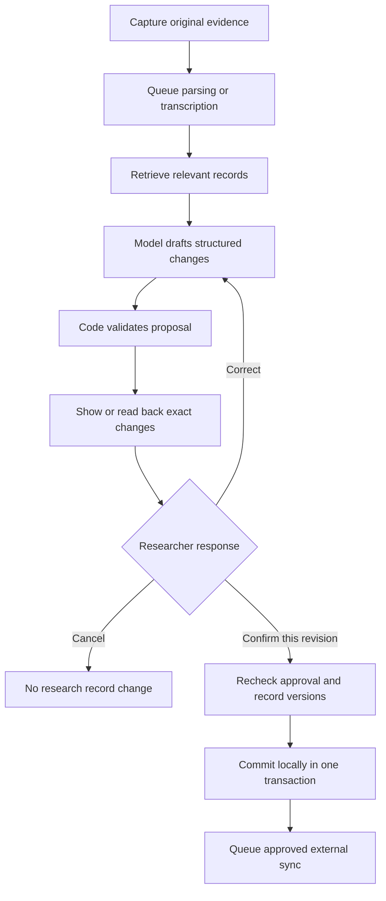

# Labgarden architecture proposal

Status: Draft for colleague feedback. This describes a proposed backend, not implemented capabilities of the existing browser demo.

## Purpose

Labgarden is a local-first research assistant that accepts voice, images, text and CSV, and helps maintain connected projects, experiments, protocol versions, samples, datasets and observations. Researchers can bring their own model endpoints. Small local models perform bounded maintenance tasks; research records remain independent of any model.

**The central requirement: explain proposed changes and obtain explicit verbal or typed confirmation before committing them.** A model may draft a proposal, but it cannot approve it.

## Three product directions

1. **Notebook companion — recommended starting point.** Capture an observation, propose an experiment update, review it and export or sync the approved result.
2. **Protocol studio.** Connect versioned methods to experiments and curate reviewed teaching material for Carpentries Workbench.
3. **Project garden.** Connect research questions, evidence, experiments and decisions; surface missing information and candidate links.

Start by completing the notebook workflow before expanding the other directions.

## Proposed components

| Component | Responsibility |
| --- | --- |
| R / Shiny workspace | Capture, graph exploration, proposal comparison, corrections and approval |
| Core R services | Validate proposals, enforce approval, maintain versions and commit records |
| SQLite | Records, relationships, sources, proposals, approvals, events and persistent jobs |
| Local file store | Preserve original evidence separately from generated derivatives |
| One background worker | Process transcription, indexing and inference jobs sequentially |
| Model adapters | Replaceable local or user-supplied inference endpoints |
| Integration adapters | Export and explicitly approved external writes, initially eLabFTW |
| MCP interface | Search and drafting tools plus interactive review; no model-accessible approval tool |

The knowledge graph stores relationships. The workflow orchestrates processing. Neither requires a separate model per node or an autonomous agent framework.

## Processing and approval



Evidence intake is separate from committing changes to authoritative research records. The application should clearly state when a submitted capture is saved, where it is stored and whether any inference endpoint receives it.

Each proposal contains an ID, revision, canonical content hash, target records and their expected versions, allowed operations, supporting evidence references and unresolved questions. Show additions, replacements and removals explicitly. Do not hide substantive changes inside a summary.

Example: “Add ‘filtration took longer’ to Experiment 015 and link sample ST8-02. Leave the protocol unchanged. Confirm?”

### Approval invariants

- The authenticated user approves an exact proposal revision and hash.
- Corrections create a new revision and require fresh confirmation.
- Spoken confirmation is collected in a dedicated interaction after the proposal is presented. Text in an uploaded recording cannot authorize its own proposed changes.
- Unclear speech or an ambiguous “yes” triggers clarification. Confirmation is bound to the active proposal, user and session.
- Models and ordinary MCP tools cannot mint approvals or invoke unrestricted writes.
- Authorization is checked again at commit. A stale target version blocks the commit and requires reconciliation and renewed approval.
- Repeated requests cannot apply the same proposal twice.
- Audit history records the approved operations, evidence, user and time. Voice approval does not itself provide biometric identity verification.
- Errors roll back the local transaction. Later corrections are recorded as new changes rather than erasing history.

Persist approved content and an external-sync job atomically in the local database. Local commit and eLabFTW synchronization have separate visible statuses. Before an external write, check for conflicting remote edits where the API permits; conflicts require review. Use deduplication identifiers where supported and reconcile uncertain outcomes before retrying. Cross-system atomicity and exactly-once remote delivery are not assumed.

## Research graph and storage

Suggested record types: Project, Experiment, ProtocolVersion, Sample, Dataset, Observation and ResearchQuestion.

Example relationships:
- Experiment BELONGS_TO Project
- Experiment USES ProtocolVersion
- Experiment ANALYZES Sample
- Experiment PRODUCES Dataset
- Observation SUPPORTED_BY Source
- Dataset DERIVED_FROM Dataset

Use stable identifiers and explicit relationship types. Embeddings suggest candidate matches; they do not establish identity or scientific truth. Keep protocol versions immutable once referenced, with later changes creating new versions.

Initial tables:
- records: typed records with current version
- relationships: typed edges with evidence and change references
- sources: original file metadata, content digest and storage location
- proposals: immutable revisions, operations and target version expectations
- approvals: user confirmation bound to a proposal revision and hash
- events: append-only application change history
- jobs: persistent work queue, status and retry information
- external_mappings: local-to-remote IDs and synchronization state

SQLite is the starting choice for a small deployment. Foreign keys, explicit constraints and transactional writes enforce integrity. Reconsider a dedicated graph service only when measured query or collaboration needs justify it. Back up the database and evidence together and test restoration.

## Models and the 16 GB Linux server

Plan for CPU operation first; treat the GTX 850M as optional acceleration pending hardware and driver checks. NVIDIA lists it at CUDA compute capability 5.0. Current Ollama documentation requires driver 570 or newer for compute capabilities 5.0–6.2. VRAM, CPU, runtime compatibility, thermal behavior and actual throughput remain to be measured.

| Task | Initial candidate | Boundary |
| --- | --- | --- |
| Tagging and explicit field extraction | Qwen3 1.7B, Q4 | Draft structured suggestions with source references |
| Harder extraction or short summaries | Qwen3 4B Instruct, Q4 | Load on demand after benchmarking |
| Similarity search | Multilingual MiniLM-L12-v2 | Candidate retrieval, not factual validation |
| Speech transcription | Whisper base or small via whisper.cpp | Preserve source and flag uncertain terms |
| Basic image description | SmolVLM-256M, exploratory | Evaluate on actual lab images; no automatic scientific interpretation |
| CSV inspection | R parsers and validation functions | Compute types, missingness and summaries directly |

Qwen3 download sizes are approximately 1.4 GB for 1.7B Q4 and 2.5 GB for 4B Q4; runtime memory is higher. These are candidates, not measured performance claims. Start with one inference job at a time and a 2–4K-token context budget. Retrieve relevant records instead of sending entire projects.

Use the same loaded language model for several gardening roles, each with a bounded prompt and output schema. Unload larger workers when idle. Keep R analysis workloads from exhausting memory alongside inference.

## Bring your own model

Define an adapter contract around capabilities, not brands:

```text
capabilities() -> supported modalities, limits and endpoint identity
generate_proposal(context, schema) -> structured candidate operations
embed(texts) -> vectors
transcribe(audio) -> transcript with source alignment where available
```

An adapter may implement only some capabilities. Local and remote workers use the same proposal validation rules. Remote processing requires an explicit endpoint choice and a clear preview of the context leaving the server. Model output is untrusted input; it cannot become executable R, SQL or unrestricted tool calls.

MCP is an interoperability boundary, not the source of authority. Expose bounded operations such as search_records, get_experiment and draft_update. Route any subsequent approval through the authenticated review interface.

## Suggested code layout

```text
labgarden/
  app.R
  R/
    capture.R
    graph.R
    proposals.R
    approvals.R
    commit.R
    jobs.R
    models/
      interface.R
      ollama.R
      remote.R
    tools/
      transcribe.R
      inspect_csv.R
      search.R
    integrations/
      elabftw.R
      mcp.R
  tests/
  data/
```

Run the worker independently of open browser sessions so jobs survive UI disconnects. Shiny ExtendedTask can keep interactive operations responsive; it does not replace a durable queue. shinymcp is a candidate interface layer. Carpentries Workbench is a lesson-publishing destination rather than the research database.

## First implementation and acceptance criteria

Build one vertical slice: text capture → existing experiment selection → structured proposal → correction or approval → durable local commit → export.

Before adding live external writes, verify:
- An unapproved proposal cannot change a research record.
- Editing a proposal invalidates prior approval.
- Stale target versions and unauthorized users are rejected.
- Duplicate submissions commit once.
- Failed commits leave no partial local changes.
- Every applied change resolves to its evidence and approval.
- Restarting the application preserves records and pending jobs.
- A spoken correction cannot be mistaken for approval.
- A failed or uncertain external sync remains visible and does not silently duplicate data.

Then add CSV inspection, local model extraction, speech, image intake, and the eLabFTW adapter incrementally.

## Questions for colleagues

1. Which capture-to-record workflow would save the most time in your lab?
2. What changes require individual approval, and what may be approved as an explicit batch?
3. Which identifiers and protocol-version rules must match existing lab practice?
4. Should eLabFTW remain the authoritative notebook, with Labgarden storing only proposals and graph indexes?
5. Which languages and scientific vocabulary should the first evaluation cover?
6. What representative notes, CSVs and images can be used to assess accuracy?
7. What permissions, retention, backups and deployment requirements matter for a shared lab?
8. What should the gardener never infer without asking?

## References

- [Existing concept repository](https://github.com/PeeterLaas/labgarden)
- [Shiny nonblocking operations](https://shiny.posit.co/r/articles/improve/nonblocking/)
- [shinymcp](https://github.com/jameshwade/shinymcp)
- [SQLite foreign keys](https://www.sqlite.org/foreignkeys.html)
- [eLabFTW API](https://doc.elabftw.net/docs/usage/api/)
- [Carpentries Workbench](https://carpentries.org/workbench/)
- [NVIDIA legacy GPU capabilities](https://developer.nvidia.com/cuda/gpus/legacy)
- [Ollama hardware support](https://docs.ollama.com/gpu)
- [Qwen3 model sizes](https://registry.ollama.com/library/qwen3/tags)
- [Multilingual Sentence Transformers](https://sbert.net/examples/sentence_transformer/training/multilingual/README.html)
- [whisper.cpp](https://github.com/ggml-org/whisper.cpp)
- [SmolVLM-256M model card](https://huggingface.co/HuggingFaceTB/SmolVLM-256M-Instruct)
